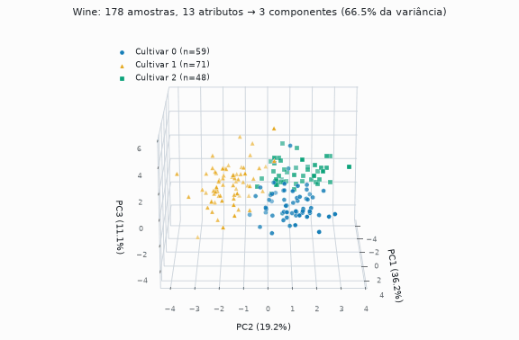
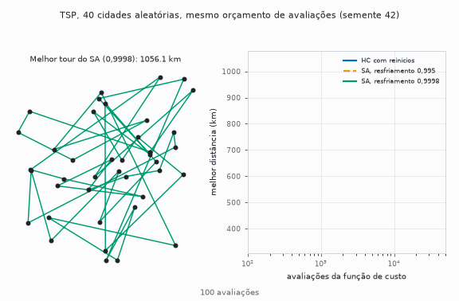
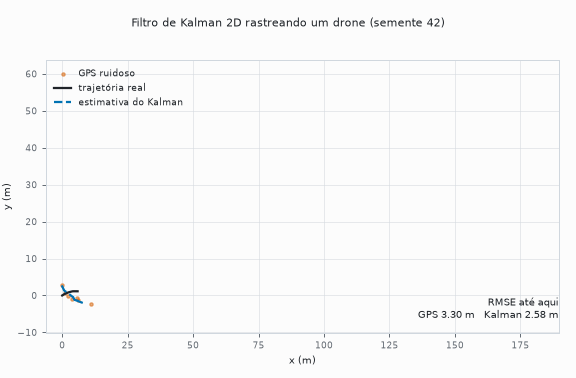
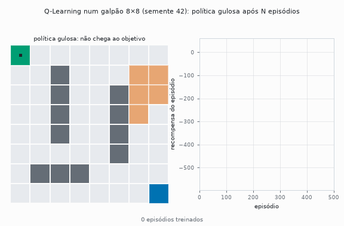

# Portfólio de Inteligência Artificial

[](https://github.com/Acciolyy/portfolio-ia/actions/workflows/ci.yml)

Projetos da disciplina Inteligência Artificial (FGA0221, UnB), implementados do zero e revisados em outubro de 2026.

<p align="center">
  <picture>
    <source media="(prefers-color-scheme: dark)" srcset="docs/assets/wine-pca-3d-dark.gif">
    
  </picture>
  <br>
  <sub>Wine: 13 atributos químicos projetados em 3 componentes. É o dado do <a href="portfolio-4-machine-learning">Portfólio 4</a>, onde o K-Means recupera os cultivares sem usar rótulos (ARI 0,8975).</sub>
</p>

## Resultados

Média ± desvio amostral (n−1) sobre as sementes indicadas. Cada número vem de um script do repositório (`--seeds`, `--repeat` ou `--sweep`; ver `make seeds`).

| Projeto | Técnica | Problema / dataset | Métrica | Valor |
|---|---|---|---|---|
| [P2](portfolio-2-busca-otimizacao) | BFS | grafo cíclico de 9 nós, A→I | nós visitados | 9 (caminho mínimo, 4 arestas) |
| P2 | DFS | idem | nós visitados | 8 (mesmo caminho neste grafo; não garante o mínimo) |
| P2 | A\* | campus FGA, 4 cenários até o RU | custo da rota | ótimo nos 4 (330, 260, 250 e 290 m) |
| P2 | Greedy | idem | custo da rota | ótimo em 3 de 4; `Gate→RU` custa 400 m contra 330 m (+21%) |
| P2 | Hill Climbing (2-opt) | TSP: 10 cidades do DF · 40 cidades aleatórias, 30 sementes, 50 mil avaliações | distância | 164,48 ± 0,00 km (ótimo exato) · 333,63 ± 11,56 km |
| P2 | Hill Climbing com reinícios | idem | distância | 164,48 ± 0,00 km (ótimo exato) · 318,55 ± 3,85 km |
| P2 | Simulated Annealing (resfriamento 0,995) | idem | distância | 164,48 ± 0,00 km (ótimo exato) · 334,30 ± 10,89 km |
| P2 | Simulated Annealing (resfriamento 0,9998) | idem | distância | 164,48 ± 0,00 km (ótimo exato) · 319,15 ± 4,95 km |
| P2 | Algoritmo genético | N-Rainhas, 30 sementes, limite de 2.000 gerações | sucesso · gerações | N=8: 30/30 · 1,9 ± 1,0; N=12: 21/30; N=16: 21/30 |
| P2 | Backtracking com e sem MRV | coloração do Centro-Oeste | nós · backtracks | 19 · 0 nos dois; MRV ≈ 8× mais lento (0,09 contra 0,01 ms, mediana de 2.000 execuções) |
| P2 | Agente lógico (Wumpus) | 2.730 mundos 4×4 com 1 Wumpus e 1 poço | mortes · ouro coletado | 0 mortes · 1.340 mundos (49,7% dos 2.698 em que o ouro era alcançável) |
| [P3](portfolio-3-modelos-probabilisticos) | Rede bayesiana (`pgmpy`) | diagnóstico de defeito no café | P(defeito) sem fatores · com temperatura e tempo altos | 3,0% · 74,6% |
| P3 | HMM, Viterbi (próprio) | 30 sequências sintéticas de 200 eventos | acurácia do estado oculto | 71,88% ± 3,36 |
| P3 | HMM, Forward (próprio) | idem | acurácia do estado oculto | 71,45% ± 3,47 (sem memória temporal: 68,35% ± 3,46) |
| P3 | Filtro de Kalman 2D (próprio) | drone com GPS ruidoso, 30 trajetórias sintéticas | RMSE de posição | 2,27 ± 0,21 m contra 5,66 ± 0,22 m do GPS bruto (−59,8% ± 3,4) |
| [P4](portfolio-4-machine-learning) | Gradient Boosting | Wine (178 amostras), validação cruzada 5×10 | acurácia | 95,99% ± 4,28 |
| P4 | Regressão logística | idem | acurácia | 98,32% ± 1,60 |
| P4 | K-Means + PCA | Wine sem rótulos | ARI · silhueta | 0,8975 · 0,285 (máximo em k=3) |
| P4 | Q-Learning | grid 8×8 com obstáculos e zona de risco, 10 sementes | passos · retorno da política final | 14 passos, retorno 37 em 10/10 (ótimo exato) |
| P4 | CNN LeNet-5 (PyTorch) | MNIST, 55 mil treino / 5 mil validação / 10 mil teste, 5 sementes | acurácia de teste | 98,74% ± 0,07 (validação: 98,51% ± 0,19) |

## Portfólio 2: busca, otimização e agentes lógicos

[Pasta](portfolio-2-busca-otimizacao). Seis algoritmos clássicos em Python puro, com uma classe abstrata por família (busca cega, informada, local) e `@dataclass` para os resultados: BFS e DFS, A\* e Greedy sobre o mapa do campus, Hill Climbing e Simulated Annealing com vizinhança 2-opt, algoritmo genético com codificação por permutação, CSP por backtracking com MRV e um agente de conhecimento no Mundo do Wumpus. O A\* só é ótimo com heurística admissível, e a heurística do campus vale apenas para o destino RU; por isso a busca recusa objetivos com h(objetivo) ≠ 0 e há uma função que confere a tabela contra Dijkstra. No TSP, o 2-opt com permutações mantém todo tour válido por construção, e o ótimo das 10 cidades vem de força bruta (181.440 tours), o que dá um gap real em vez de uma comparação só entre heurísticas. No Wumpus o agente consulta só a topologia do grid e as percepções (brisa, fedor, brilho), nunca a posição do Wumpus, dos poços ou do ouro; ele só entra em células provadamente seguras, e por isso nunca morreu.

<p align="center">
  <picture>
    <source media="(prefers-color-scheme: dark)" srcset="docs/assets/tsp-40-cidades-dark.gif">
    
  </picture>
  <br>
  <sub>TSP com 40 cidades, semente 42. Na tabela, a média de 30 sementes: o resfriamento 0,995 empata com o Hill Climbing simples; o 0,9998 empata com o Hill Climbing com reinícios.</sub>
</p>

Por que o SA não ganhou: com temperatura inicial 800 e resfriamento 0,995, a temperatura cai abaixo de 1 km (a ordem de grandeza das diferenças de custo) por volta da iteração 1.300 e chega perto de zero por volta da 3.000. Depois disso o SA aceita só melhorias e as cerca de 47 mil avaliações restantes funcionam como busca gulosa. É uma explicação consistente com o experimento do cronograma lento (334,30 → 319,15 km), mas só esses dois cronogramas foram comparados.

## Portfólio 3: incerteza

[Pasta](portfolio-3-modelos-probabilisticos). Três modelos, em complexidade crescente. A **rede bayesiana usa `pgmpy`** (`DiscreteBayesianNetwork` e `VariableElimination`); a estrutura e as tabelas de probabilidade condicional são definidas à mão, e um teste confere a inferência contra a enumeração da distribuição conjunta. **HMM, Viterbi, Forward e Kalman são implementações próprias em `numpy`.** O Viterbi trabalha em log-probabilidades para evitar underflow, e um teste o compara com a busca exaustiva sobre todos os caminhos. No Kalman, o estado é posição e velocidade em X e Y, só a posição é observada, a covariância do ruído de processo é bloco-diagonal por eixo (as acelerações dos eixos são independentes) e a atualização de P usa a forma de Joseph, que mantém a matriz simétrica e semidefinida positiva sob arredondamento. Esses dois pontos têm teste.

<p align="center">
  <picture>
    <source media="(prefers-color-scheme: dark)" srcset="docs/assets/kalman-drone-dark.gif">
    
  </picture>
  <br>
  <sub>Kalman na semente 42 (5,64 m contra 2,38 m). Em 30 sementes: 5,66 ± 0,22 m contra 2,27 ± 0,21 m.</sub>
</p>

No HMM, Viterbi e Forward ficam equivalentes nesta configuração: a diferença pareada é de 0,4 ponto, sem padrão consistente (Viterbi melhor em 14 sequências, Forward em 12, empate em 4). O resultado que se sustenta é que o modelo temporal fica cerca de 3,5 pontos acima do baseline sem memória (68,35% ± 3,46), que escolhe o estado mais provável olhando só a observação atual.

## Portfólio 4: aprendizado de máquina

[Pasta](portfolio-4-machine-learning). Os quatro paradigmas em scikit-learn e PyTorch. Os dois primeiros usam o dataset Wine, para comparar o mesmo problema com e sem rótulos. A padronização dos atributos entra num `Pipeline`, então é ajustada só no treino de cada fold; os dois classificadores são avaliados nas mesmas partições, o que permite a diferença pareada (a regressão logística fica à frente em 24 folds, empata em 17 e perde em 9, de 50). No não supervisionado, o K-Means roda nas 13 dimensões padronizadas e o PCA serve só para desenhar; o k vem da silhueta, e os rótulos aparecem apenas na auditoria final. O Q-Learning tem referência exata: Dijkstra sobre o grid dá o mínimo de 14 passos e o retorno ótimo 37, e a política gulosa atinge os dois em 10 de 10 sementes. A LeNet-5 (ReLU no lugar da tanh) usa uma validação separada do treino e avalia o teste uma única vez por execução.

<p align="center">
  <picture>
    <source media="(prefers-color-scheme: dark)" srcset="docs/assets/qlearning-grid-dark.gif">
    
  </picture>
  <br>
  <sub>Q-Learning, semente 42: a política gulosa após N episódios e a curva de recompensa.</sub>
</p>

A hipótese para a regressão logística superar o Gradient Boosting no Wine é que as classes são quase linearmente separáveis depois de padronizar. O código não testa isso.

## Revisão de 2026

Em outubro de 2026 fiz uma revisão do repositório, no estilo de uma revisão de código sênior. O que foi encontrado e corrigido:

| Achado | Antes | Depois | Por que o novo é o confiável |
|---|---|---|---|
| **Vazamento no MNIST**: o teste servia de validação a cada época | 98,90% (um treino) | **98,74% ± 0,07** (5 sementes) | 5 mil amostras são separadas do treino para validação, e o teste só é avaliado no fim, uma vez por execução. O número antigo vinha de um conjunto que acompanhou o treino. |
| **Wine**: regressão logística com 100% em 45 amostras; gradient boosting com validação cruzada e a regressão logística sem | 100% contra 95,49% ± 3,88 | 98,32% ± 1,60 contra 95,99% ± 4,28 | Os dois modelos passam pelo mesmo protocolo (5×10 folds, mesmas partições). Um erro no split de 45 amostras valia 2,2 pontos. A conclusão (regressão logística à frente) se mantém, com a margem real. |
| **Kalman**: matriz Q de posto 1 acoplava as acelerações de X e Y | RMSE 4,13 ± 2,05 m; pior que o GPS em 7 de 30 sementes | **2,27 ± 0,21 m**; 0 de 30 | A semente 42 era favorável (2,35 m) e escondia a instabilidade. Com Q bloco-diagonal o resultado é estável entre sementes. |
| **A\***: tabela de heurística do RU reutilizada para o MEsp | estimativas inadmissíveis (h(Est)=245 contra custo real 100) | a busca recusa h(objetivo) ≠ 0; teste de admissibilidade | A otimalidade do A\* depende da admissibilidade, e a rota certa no cenário MEsp era coincidência. |
| **HMM**: Viterbi 72,5% contra Forward 70,0% | uma sequência | 71,88% contra 71,45% (30 sequências) | A diferença original era ruído. |
| **TSP**: "o SA é mais robusto contra ótimos locais" | uma semente, 10 cidades | nas 10 cidades todos acham o ótimo; nas 40, o SA com os parâmetros atuais empata com o Hill Climbing simples | A afirmação vale na teoria, mas não apareceu nas instâncias medidas com orçamento igual. |
| **Busca cega**: "DFS mais rápido (0,0084 contra 0,0140 ms)" | uma medição, que incluía o aquecimento do interpretador | ≈ 0,002 ms nos dois (mediana de 2.000 execuções) | A diferença vinha da primeira chamada. |
| **A\* contra Greedy**: "mesma rota de 250 m" | verdade só em `Est→RU` | Greedy +21% em `Gate→RU` (400 contra 330 m) | Mostra a diferença que a teoria prevê. |
| **Algoritmo genético**: "solução em 2 gerações" | uma semente, N=8 | N=8: 1,9 ± 1,0 gerações; N=12 e N=16: 21 de 30 execuções | N=8 é fácil demais; com o mesmo ajuste, tabuleiros maiores falham em parte das sementes. |
| Rótulo errado: o tempo de **predição** era impresso como tempo de treino | `training_time_ms` | `inference_time_ms` | Só o rótulo mudou. |
| Docstrings dos 3 scripts do P3 vinham depois de `from __future__` (Python não os reconhecia); imports e variáveis sem uso | | corrigidos com `ruff` | |

Também entraram sementes fixas e documentadas, 28 testes de sanidade (A\* contra Dijkstra, Viterbi contra busca exaustiva, inferência da rede contra enumeração, Kalman, caminho do Q-Learning contra BFS, entre outros), `ruff`, CI no GitHub Actions e um `requirements.txt` com as versões mínimas confirmadas rodando. Os prints de terminal antigos foram removidos porque mostravam números anteriores à revisão.

## Limitações

- **Dados sintéticos.** As sequências do HMM são amostradas do mesmo modelo usado para decodificar, e o Kalman roda sobre trajetórias simuladas com ruído gaussiano de variância conhecida pelo filtro. As métricas medem a qualidade da inferência, não o ajuste a dados reais. As tabelas de probabilidade da rede bayesiana e as matrizes do HMM são definidas à mão, não aprendidas.
- **Instâncias pequenas.** TSP com 10 e 40 cidades; N-Rainhas até N=16; o CSP do Centro-Oeste resolve com 0 backtracks, então não discrimina o MRV; o grafo do campus tem 10 nós; o Wumpus foi varrido só com 1 Wumpus e 1 poço.
- **Hiperparâmetros não otimizados sistematicamente.** Gradient Boosting (150 árvores, taxa 0,08, profundidade 2), LeNet-5 (8 épocas, Adam 1e-3), Q-Learning (α=0,15, γ=0,95), GA (população 200) e SA (T₀=800) usam valores fixos. Para o SA foram comparados só dois cronogramas.
- **Wumpus: 49,7% de ouro coletado.** O agente coletou o ouro em 49,7% dos mundos em que ele era alcançável sem passar por célula fatal. A inferência é segura, mas conservadora: ele só se move para células provadamente seguras e, com uma percepção ambígua (por exemplo, brisa na origem sem vizinhos descartados), espera em vez de arriscar. Não houve mortes, ao custo de deixar o ouro para trás em metade dos casos.
- **Q-Learning.** O limite de 200 passos por episódio é tratado como estado terminal na atualização, o que mistura terminação e truncamento. O ambiente é determinístico e pequeno.
- **MNIST.** A validação tem 5 mil amostras, então é ruidosa (±0,19 entre sementes), e o treino é curto, sem aumento de dados.
- **Versões.** As versões mínimas de `requirements.txt` foram testadas só com Python 3.12.

## Stack

Python 3.12 · NumPy · scikit-learn · PyTorch · pgmpy · networkx · matplotlib · pytest · ruff · GitHub Actions.

## Rodar localmente

```bash
python3.12 -m venv .venv && source .venv/bin/activate
pip install -r requirements.txt                 # + requirements-dev.txt para pytest e ruff
make p2 p3 p4        # roda os scripts de src/ de cada portfólio; make seeds repete com várias sementes
make test lint       # 28 testes de sanidade e ruff
```
