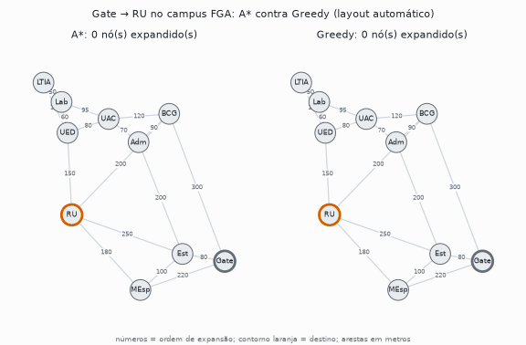
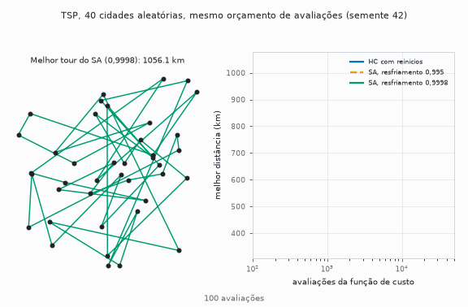

# Portfólio 2: métodos clássicos de IA (busca, otimização e agentes lógicos)

Seis implementações de algoritmos clássicos, em Python puro, com uma classe abstrata base por família de algoritmo e `@dataclass` tipado para o resultado de cada execução. Os números abaixo vêm dos próprios scripts (`--seeds`, `--repeat` ou `--sweep`); veja "Reexecutar" no fim. Desvios são amostrais (n−1).

## Projetos

### 1. Busca não informada: BFS contra DFS (`projeto_01_busca_cega.py`)
Navegação em um grafo cíclico de 9 nós (A→I), com fila FIFO (BFS) e pilha LIFO (DFS) e controle de estados visitados para não entrar em loop.

**Resultado:** BFS visita 9 nós e DFS visita 8; os dois retornam o caminho A→B→E→H→I, que tem o número mínimo de arestas. A diferença de tempo não é consistente: a mediana de 2.000 execuções é de cerca de 0,002 ms nos dois. (Uma medição única, como a que este README mostrava antes, inclui o aquecimento do interpretador e inverte a ordem.) A diferença de memória entre O(b^d) e O(b·m) é teórica e não foi medida.

### 2. Busca informada: A\* contra Greedy (`informed_search.py`)
Rotas a pé no campus FGA/UnB, com heurística de distância em linha reta. A tabela `FGA_HEURISTICS` foi montada para o destino **RU** e é admissível e consistente para ele. A busca levanta `ValueError` se `h(objetivo) ≠ 0`, e `inadmissible_nodes()` confere uma tabela contra os custos reais (Dijkstra).

| Cenário | A\* (custo · nós) | Greedy (custo · nós) |
|---|---|---|
| Gate → RU | 330 m · 3 | **400 m** · 3 |
| LTIA → RU | 260 m · 4 | 260 m · 3 |
| Est → RU | 250 m · 2 | 250 m · 2 |
| Adm → RU | 290 m · 5 | 290 m · 3 |

**Resultado:** o A\* é ótimo nos 4 cenários (e partindo de qualquer prédio; há teste contra Dijkstra). O Greedy empata em 3 e, em `Gate→RU`, produz uma rota 21% mais longa, com o mesmo número de nós. Em `LTIA→RU` e `Adm→RU` ele expande menos nós que o A\*. Tempos medianos: 0,004 a 0,012 ms, sem diferença que importe nessa escala.

<p align="center">
  <picture>
    <source media="(prefers-color-scheme: dark)" srcset="../docs/assets/astar-vs-greedy-dark.gif">
    
  </picture>
  <br>
  <sub>Expansão de nós de Gate até RU. O layout do grafo é automático (as distâncias das arestas aparecem em metros); não é um mapa geográfico.</sub>
</p>

### 3. Busca local: Hill Climbing, Hill Climbing com reinícios e Simulated Annealing (`tsp_local_search.py`)
TSP com vizinhança 2-opt em duas instâncias: as 10 Regiões Administrativas do DF e 40 cidades aleatórias (semente da instância 2026, separada das sementes dos algoritmos). Os três algoritmos têm o mesmo orçamento de 50.000 avaliações da função de custo, 30 sementes. O ótimo das 10 cidades vem de força bruta (181.440 tours: 164,48 km); nas 40 a referência é o melhor tour visto em todas as execuções (310,75 km).

| Algoritmo | 10 cidades (DF) | 40 cidades: distância | melhor · pior | gap médio |
|---|---|---|---|---|
| Hill Climbing | 164,48 ± 0,00 km, ótimo 30/30 | 333,63 ± 11,56 km | 316,06 · 353,80 | 7,36% |
| Hill Climbing com reinícios | 164,48 ± 0,00 km, ótimo 30/30 | 318,55 ± 3,85 km | 311,84 · 326,37 | 2,51% |
| SA, resfriamento 0,995 (atual) | 164,48 ± 0,00 km, ótimo 30/30 | 334,30 ± 10,89 km | 313,75 · 358,28 | 7,58% |
| SA, resfriamento 0,9998 | 164,48 ± 0,00 km, ótimo 30/30 | 319,15 ± 4,95 km | 310,75 · 331,93 | 2,70% |

**Resultado:** nas 10 cidades todos chegam ao ótimo (o Hill Climbing simples para sozinho em cerca de 100 avaliações), então a instância não separa os algoritmos. Nas 40, o SA com os parâmetros atuais empata com o Hill Climbing simples, e mesmo com resfriamento lento não supera o Hill Climbing com reinícios (319,15 contra 318,55 km). A explicação que encontrei está no cronograma: com T₀ = 800 e resfriamento 0,995, a temperatura cai abaixo de 1 km (a ordem de grandeza dos Δ de custo) por volta da iteração 1.300 e chega perto de zero por volta da 3.000; as cerca de 47 mil avaliações restantes viram busca gulosa. É consistente com o cronograma lento (334,30 → 319,15 km), mas só dois cronogramas foram testados. Os hiperparâmetros do SA não foram ajustados.

<p align="center">
  <picture>
    <source media="(prefers-color-scheme: dark)" srcset="../docs/assets/tsp-40-cidades-dark.gif">
    
  </picture>
  <br>
  <sub>Semente 42. A tabela acima traz a média de 30 sementes.</sub>
</p>

### 4. Algoritmo genético: N-Rainhas (`n_queens_genetic.py`)
Codificação por permutação (sem conflitos de linha ou coluna por construção), crossover OX1, mutação por troca, seleção por torneio e elitismo. População 200, crossover 0,85, mutação 0,05, torneio 5, elitismo 2, limite de 2.000 gerações.

| N | execuções com solução | gerações (média ± desvio) | mediana · máximo |
|---|---|---|---|
| 8 | 30/30 | 1,9 ± 1,0 | 2 · 5 |
| 12 | 21/30 | 652,2 ± 906,9 | 20 · 2.000 |
| 16 | 21/30 | 749,3 ± 881,5 | 162 · 2.000 |

**Resultado:** com N=8 a solução aparece quase de imediato (a execução de semente 42 resolveu em 2 gerações). Com os mesmos parâmetros, em N=12 e N=16 cerca de 30% das sementes não resolvem em 2.000 gerações. A distribuição é muito dispersa (mediana 20 contra média 652 em N=12), o que aponta para convergência prematura em parte das execuções; essa hipótese não foi testada.

### 5. CSP: coloração de mapa (`csp_map_coloring.py`)
Estados do Centro-Oeste e vizinhos por backtracking, com MRV opcional.

**Resultado:** 19 nós e 0 backtracks com e sem MRV. O mapa é fácil demais para a heurística ajudar, e o MRV custa mais: mediana de 0,09 ms contra 0,01 ms em 2.000 execuções (cerca de 8×), por recalcular o domínio mais restrito a cada passo.

### 6. Agente baseado em conhecimento: Mundo do Wumpus (`wumpus_world.py`)
Agente num grid 4×4 que infere células seguras por lógica proposicional a partir de percepções locais (brisa, fedor, brilho). Ele consulta a topologia do grid e as percepções, nunca a posição do Wumpus, dos poços ou do ouro.

**Resultado:** no mundo de exemplo, o agente pega o ouro em 10 passos (990 pontos). Para medir além de um único mundo, `--sweep` roda o agente nos 2.730 mundos com 1 Wumpus e 1 poço:

- **0 mortes**: o agente só entra em células provadamente seguras.
- **Ouro coletado em 1.340 mundos**: 49,1% do total e 49,7% dos 2.698 mundos em que o ouro é alcançável sem passar por célula fatal.

A inferência é segura, mas conservadora: sem uma célula provadamente segura para avançar (por exemplo, brisa na origem com os dois vizinhos ainda indeterminados), o agente espera em vez de arriscar.

## Limitações
Instâncias pequenas (grafo do campus com 10 nós, TSP de 10 e 40 cidades, N ≤ 16, CSP de poucos estados). O Wumpus foi varrido só com 1 Wumpus e 1 poço. Hiperparâmetros fixos, sem busca sistemática.

## Reexecutar
Python 3.12 e `pip install -r ../requirements.txt`. A partir de `src/`:

```bash
python projeto_01_busca_cega.py --repeat 2000     # mediana de tempo
python informed_search.py --repeat 2000
python csp_map_coloring.py --repeat 2000
python tsp_local_search.py --seeds 30             # 10 e 40 cidades
python n_queens_genetic.py --seeds 30
python wumpus_world.py --sweep
```
Sem argumentos, cada script roda a demonstração de uma execução. Na raiz do repositório, `make seeds` roda todos eles.
