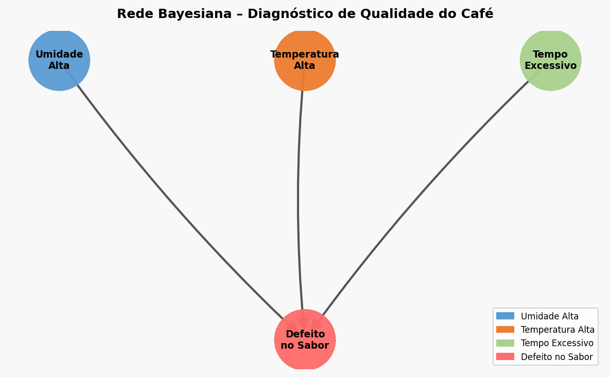
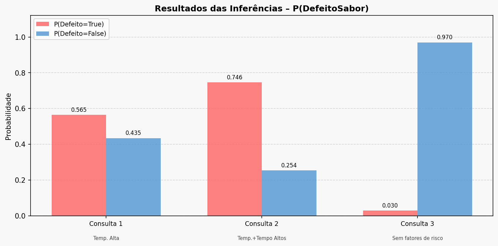
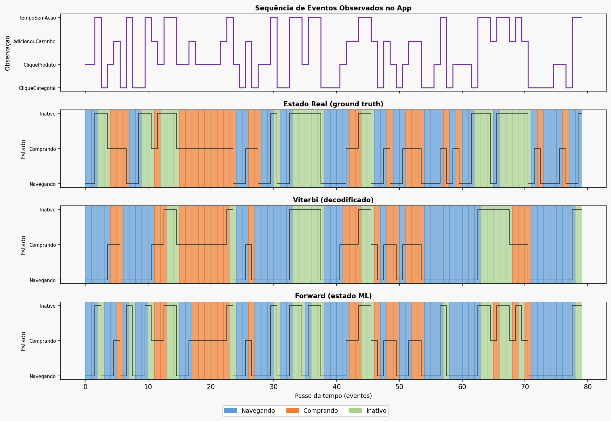
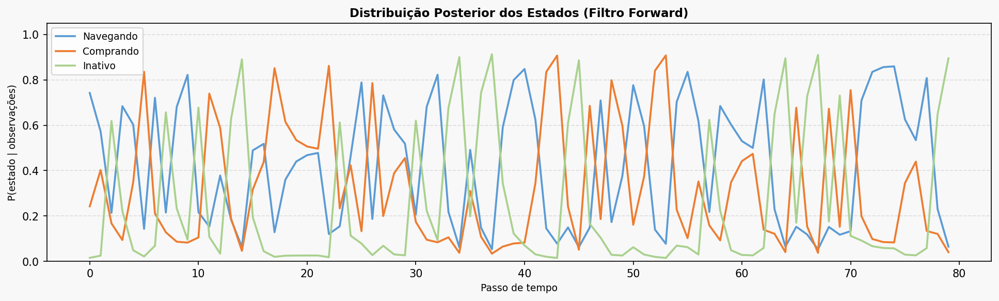
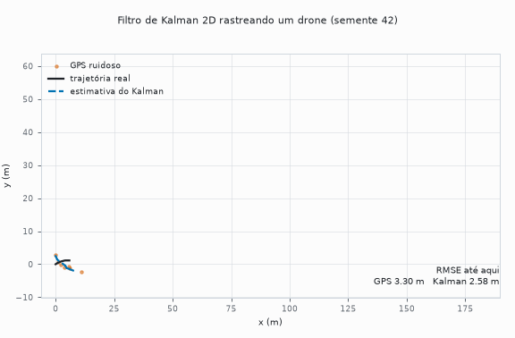
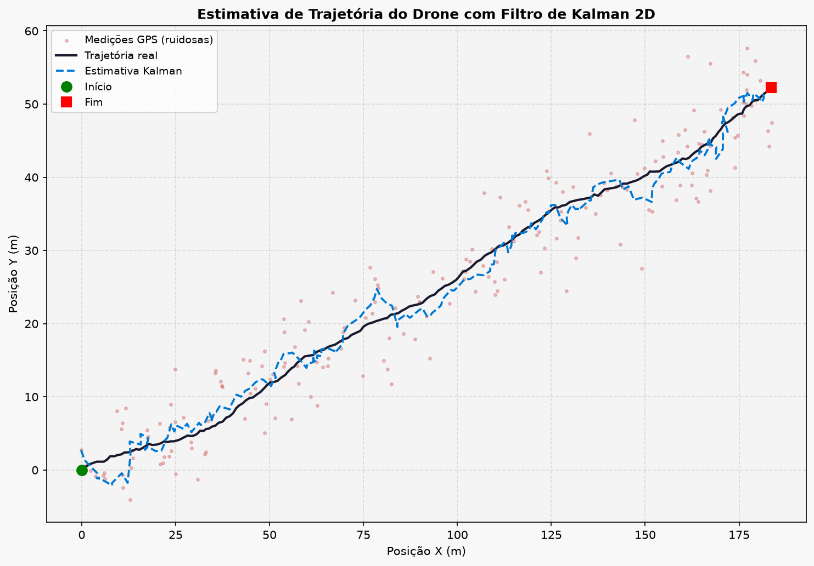
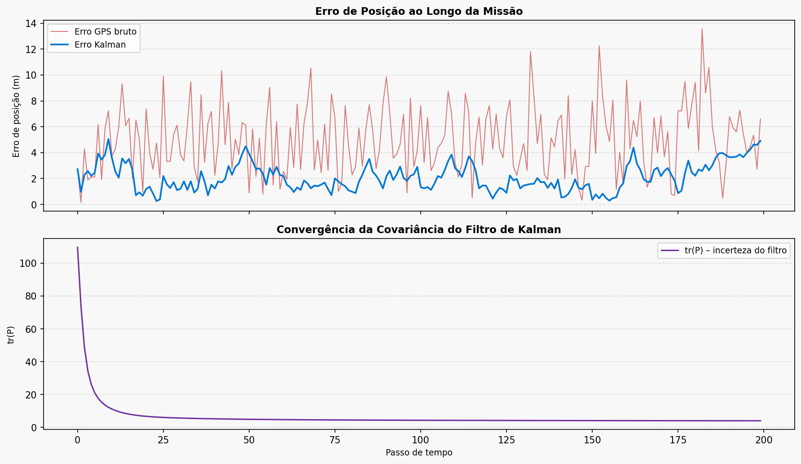

# Portfólio 3: incerteza em IA (rede bayesiana, HMM e filtro de Kalman)

Três formas de raciocinar sob incerteza, em complexidade crescente: um grafo causal estático (rede bayesiana), uma sequência com estado oculto discreto (HMM) e um sistema dinâmico com estado contínuo (filtro de Kalman).

**O que é de biblioteca e o que é próprio:** a rede bayesiana usa `pgmpy` (`DiscreteBayesianNetwork` e `VariableElimination`); HMM, Viterbi, Forward e o filtro de Kalman são implementações próprias em `numpy`, sem `hmmlearn` nem `filterpy`. Todos os dados de HMM e Kalman são sintéticos (ver "Limitações"). Desvios são amostrais (n−1).

## Projetos

### 1. Rede bayesiana: diagnóstico de qualidade de café (`projeto_01_rede_bayesiana.py`)
Três causas independentes (umidade do grão, temperatura e tempo de torra) convergem para `DefeitoSabor`. A estrutura e a tabela de probabilidade condicional (8 combinações de pais) são definidas à mão; a inferência usa eliminação de variáveis do `pgmpy`. Um teste confere o resultado contra a enumeração da distribuição conjunta.

**Resultado:** na direção causal, P(defeito) sobe de 3,0% (nenhum fator de risco) para 74,6% (temperatura e tempo altos), mais de 20 vezes. Na direção diagnóstica, dado um defeito e tempo normal, a umidade alta tem probabilidade 59,79%. Como as probabilidades vêm de tabelas escolhidas à mão, esses números mostram o comportamento do modelo, não uma medição de café real.

<p align="center">
  
  
</p>

### 2. HMM: intenção do usuário em um app (`projeto_02_hmm.py`)
HMM implementado em `numpy`, com 3 estados ocultos (Navegando, Comprando, Inativo) e 4 tipos de evento observável. O Viterbi trabalha em log-probabilidades para evitar underflow; o Forward devolve a distribuição filtrada normalizada a cada passo. Um teste compara o Viterbi com a busca exaustiva sobre todos os caminhos de um HMM pequeno.

**Resultado** (30 sequências de 200 eventos, sementes 7 a 36, amostradas do próprio modelo):

| Método | Acurácia do estado oculto |
|---|---|
| Viterbi (decodificação global) | 71,88% ± 3,36 |
| Forward (filtragem online) | 71,45% ± 3,47 |
| Sem memória temporal (estado mais provável dada só a observação atual) | 68,35% ± 3,46 |

Viterbi e Forward são equivalentes nesta configuração: a diferença pareada é de 0,4 ponto (+0,43 ± 2,41), sem padrão consistente (Viterbi melhor em 14 sequências, empate em 4, Forward melhor em 12). A execução única de semente 7 dava 72,5% contra 70,0%, e era ruído. O resultado que se sustenta é que o modelo temporal fica cerca de 3,5 pontos acima do baseline sem memória.

<p align="center">
  
  
</p>

### 3. Filtro de Kalman 2D: posição de um drone com GPS ruidoso (`projeto_03_kalman.py`)
Estado de 4 dimensões (posição e velocidade em X e Y); só a posição é observada. A covariância do ruído de processo Q é bloco-diagonal por eixo (as acelerações de X e Y são independentes), e a atualização da covariância usa a forma de Joseph, que mantém P simétrica e semidefinida positiva sob arredondamento. Testes conferem Q sem correlação entre eixos, P simétrica e semidefinida positiva a cada passo, e RMSE menor que o do GPS bruto.

**Resultado** (30 trajetórias, sementes 42 a 71, 200 passos, ruído do GPS de 4 m por eixo):

| | RMSE de posição |
|---|---|
| GPS bruto | 5,66 ± 0,22 m |
| Kalman | **2,27 ± 0,21 m** (mínimo 1,89, máximo 2,78) |
| Redução | **59,8% ± 3,4** (mínimo 52,7%, máximo 65,3%); o Kalman nunca ficou pior que o GPS |

A semente 42 sozinha dá 5,64 contra 2,38 m. Os parâmetros do filtro (ruído de processo 0,3 e ruído de medição igual ao da simulação) não foram ajustados. Uma versão anterior do código usava uma matriz Q de posto 1, que acoplava as acelerações de X e Y; com ela a média era 4,13 ± 2,05 m e o filtro ficava pior que o GPS em 7 de 30 sementes (a semente 42 era favorável: 2,35 m).

<p align="center">
  <picture>
    <source media="(prefers-color-scheme: dark)" srcset="../docs/assets/kalman-drone-dark.gif">
    
  </picture>
</p>
<p align="center">
  
  
</p>

## Limitações
- **Dados sintéticos.** O HMM decodifica sequências amostradas dos mesmos parâmetros que ele usa; o Kalman filtra trajetórias simuladas com ruído gaussiano cuja variância ele conhece. As acurácias e os RMSE medem a qualidade da inferência, não o ajuste a dados reais.
- **Parâmetros à mão.** As tabelas da rede bayesiana e as matrizes π, A e B do HMM são definidas manualmente, não aprendidas (não há Baum-Welch nem aprendizado de estrutura).
- **Kalman sem sensibilidade.** Não foi medido o efeito de um ruído de medição ou de processo mal especificado.

## Reexecutar
Python 3.12 e `pip install -r ../requirements.txt`. A partir de `src/`:

```bash
python projeto_02_hmm.py --seeds 30
python projeto_03_kalman.py --seeds 30
```
Sem argumentos, cada script roda uma execução e gera as figuras na pasta atual; `make p3` na raiz roda os três a partir de `imagens/`.
