# Portfólio 4: aprendizado de máquina (supervisionado, não supervisionado, reforço e deep learning)

Os quatro paradigmas em scikit-learn, NumPy e PyTorch. Os dois primeiros usam o mesmo dataset (composição química de vinhos) para comparar como a presença ou a ausência de rótulos muda a abordagem. O Q-Learning é implementado em NumPy, sem biblioteca de RL. Desvios são amostrais (n−1).

## Projetos

### 1. Supervisionado: cultivares de uva (`projeto_01_supervisionado.py`)
Gradient Boosting (150 árvores, taxa 0,08, profundidade 2) contra uma regressão logística como linha de base, no Wine (178 amostras, 13 atributos, 3 classes). A padronização está num `Pipeline`, então é ajustada só no treino de cada fold. Os dois modelos são avaliados com validação cruzada estratificada 5×10 nas **mesmas partições**, o que permite comparar fold a fold.

| Modelo | Acurácia (50 folds) | F1-macro |
|---|---|---|
| Gradient Boosting | 95,99% ± 4,28 | 96,15% ± 4,08 |
| Regressão logística | **98,32% ± 1,60** | 98,29% ± 1,63 |

Diferença pareada (regressão logística − Gradient Boosting): **+2,3 pontos**; a regressão logística é melhor em 24 folds, empata em 17 e perde em 9. O desvio entre folds é descritivo: folds de repetições diferentes reutilizam amostras, então ele não é um erro-padrão da média.

**Resultado:** a regressão logística supera o Gradient Boosting, com menos variação entre folds. No split único de teste (45 amostras) ela tinha dado 100% e o Gradient Boosting 97,78%; como um erro vale 2,2 pontos, esse split sozinho superestimava a diferença e o 100% não é o desempenho esperado (a validação cruzada dá cerca de 98,3%). A hipótese para o resultado é que as classes são quase linearmente separáveis depois de padronizar; o código não testa isso. Intensidade de cor (0,32), flavonoides (0,30) e prolina (0,25) concentram a importância no Gradient Boosting (split de treino).

<p align="center">
  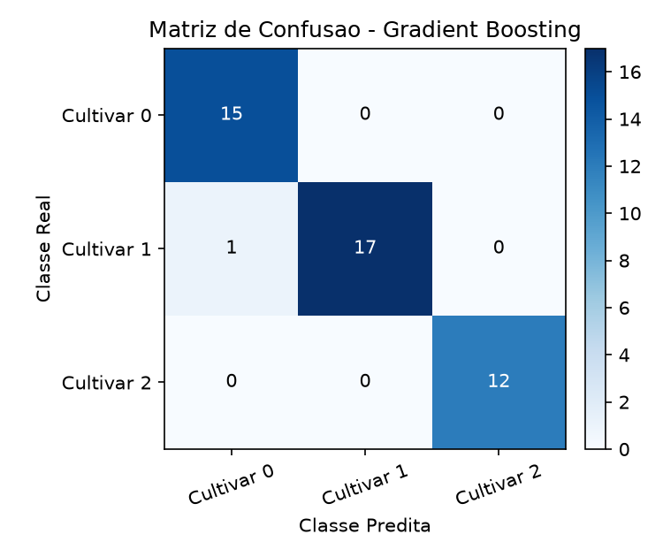
  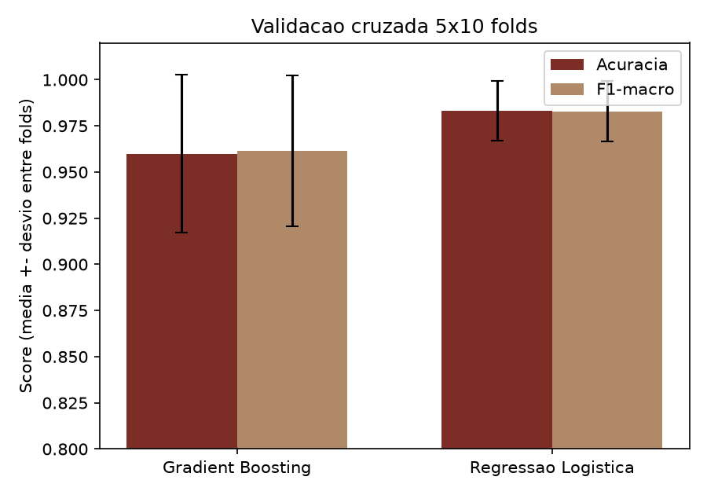
  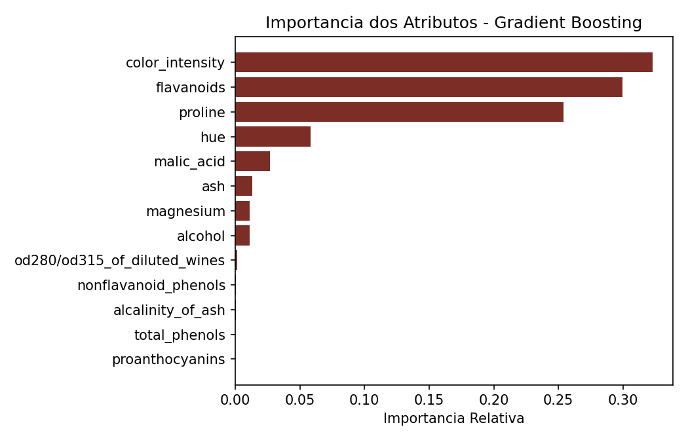
</p>

### 2. Não supervisionado: segmentação de vinhos (`projeto_02_nao_supervisionado.py`)
Mesmo dataset, sem os rótulos. K-Means nas 13 dimensões padronizadas (10 inicializações por k, `n_init=10`) e PCA só para visualização em 2D (55,4% da variância). O k é varrido de 2 a 7 pelo método do cotovelo e pela silhueta.

**Resultado:** a silhueta é máxima em k=3 (0,285), o número real de cultivares, descoberto sem rótulos. A silhueta é baixa em termos absolutos, então os grupos não são bem separados. Na validação externa, o Adjusted Rand Index é de 0,8975, com 172 das 178 amostras no grupo certo (a matriz de confusão tem 3 erros do cultivar 1 para o 0 e 3 para o 2). Os rótulos só entram nessa auditoria final.

<p align="center">
  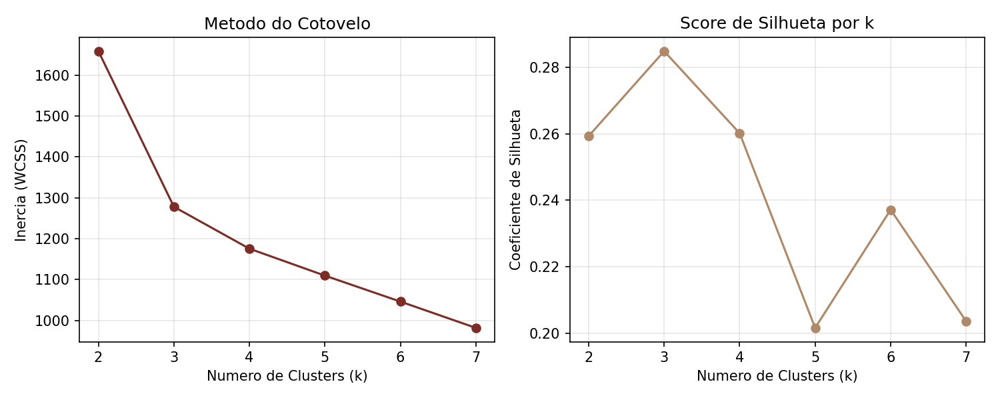
  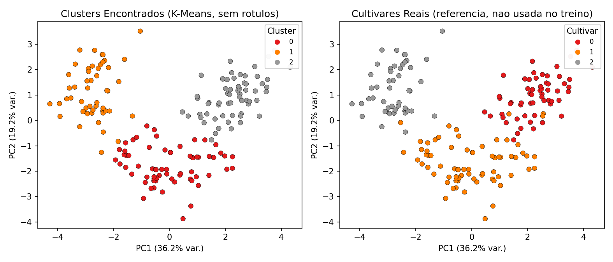
</p>

### 3. Aprendizado por reforço: navegação em grid (`projeto_03_reforco.py`)
Q-Learning (off-policy, TD) num grid 8×8 com obstáculos e uma zona de risco, sem conhecer o mapa: só recompensas (−1 por passo, −8 extra na zona de risco, +50 no objetivo). Exploração ε-greedy com decaimento exponencial (0,995 por episódio), α=0,15, γ=0,95, 500 episódios.

A referência é exata: Dijkstra sobre o grid, com os mesmos custos do ambiente, dá o mínimo de **14 passos** e o **retorno ótimo de 37**. `--seeds 10` treina um agente por semente.

**Resultado** (10 sementes, 42 a 51): a política gulosa final chega ao objetivo em 10/10, com 14 passos e retorno 37 em 10/10 (14,00 ± 0,00 e 37,00 ± 0,00), contornando os obstáculos e a zona de risco. A recompensa média por episódio vai de −228,9 ± 21,7 (20 primeiros episódios) a 35,63 ± 0,23 (20 últimos, ainda com exploração). Observação: a atualização trata o limite de 200 passos como estado terminal, o que mistura terminação e truncamento.

<p align="center">
  <picture>
    <source media="(prefers-color-scheme: dark)" srcset="../docs/assets/qlearning-grid-dark.gif">
    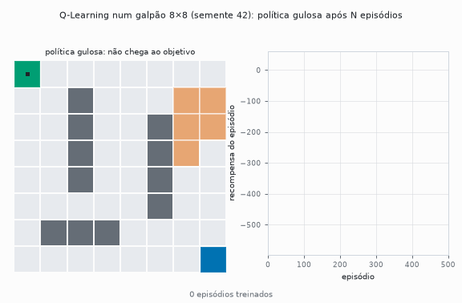
  </picture>
</p>
<p align="center">
  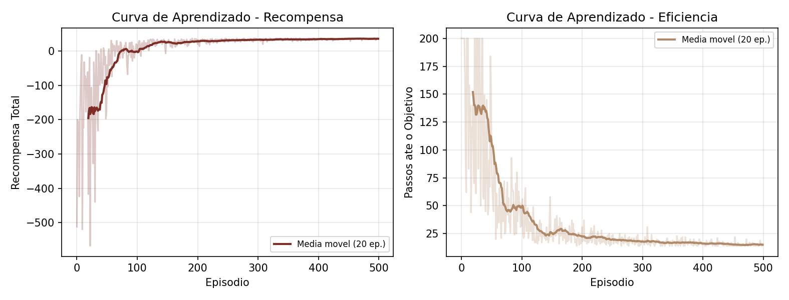
  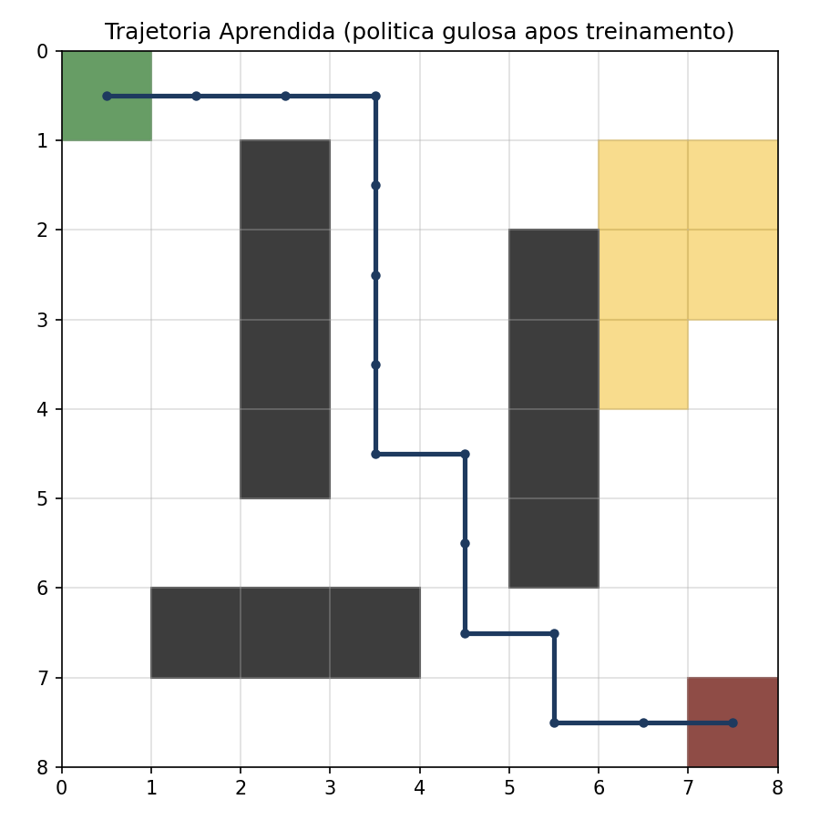
</p>

### 4. Deep learning: dígitos com CNN LeNet-5 (`projeto_04_deep_learning.py`)
Rede convolucional baseada na LeNet-5 (1998) em PyTorch, com ReLU no lugar da tanh, no MNIST. Os 60 mil exemplos de treino são divididos em **55 mil para treino e 5 mil para validação** (semente fixa), e o teste de 10 mil só é avaliado no fim, uma vez por execução. Adam, taxa 1e-3, 8 épocas, lote 128; `--seeds N` repete o treino com sementes consecutivas (a partição fica fixa).

**Resultado** (5 sementes, 42 a 46): **98,74% ± 0,07 de acurácia de teste** (98,64; 98,79; 98,76; 98,82; 98,69) e 98,51% ± 0,19 na validação. As figuras vêm da semente 42, no conjunto de teste. A versão anterior treinava e acompanhava a validação sobre o próprio conjunto de teste e reportava 98,90% de uma única execução; esse número vinha de um conjunto que orientou o treino, e o valor acima é o confiável.

<p align="center">
  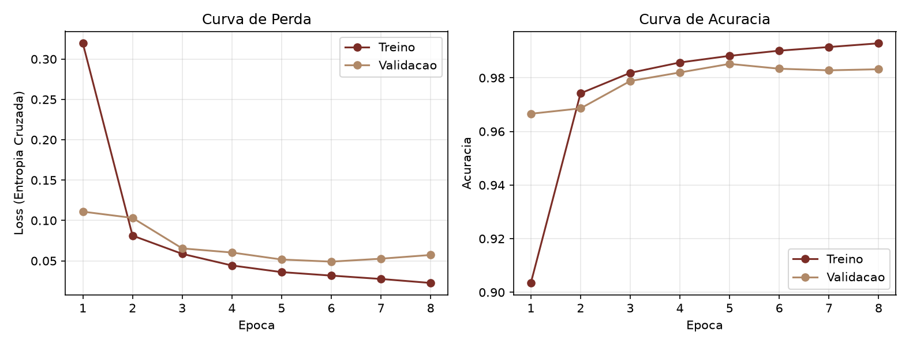
  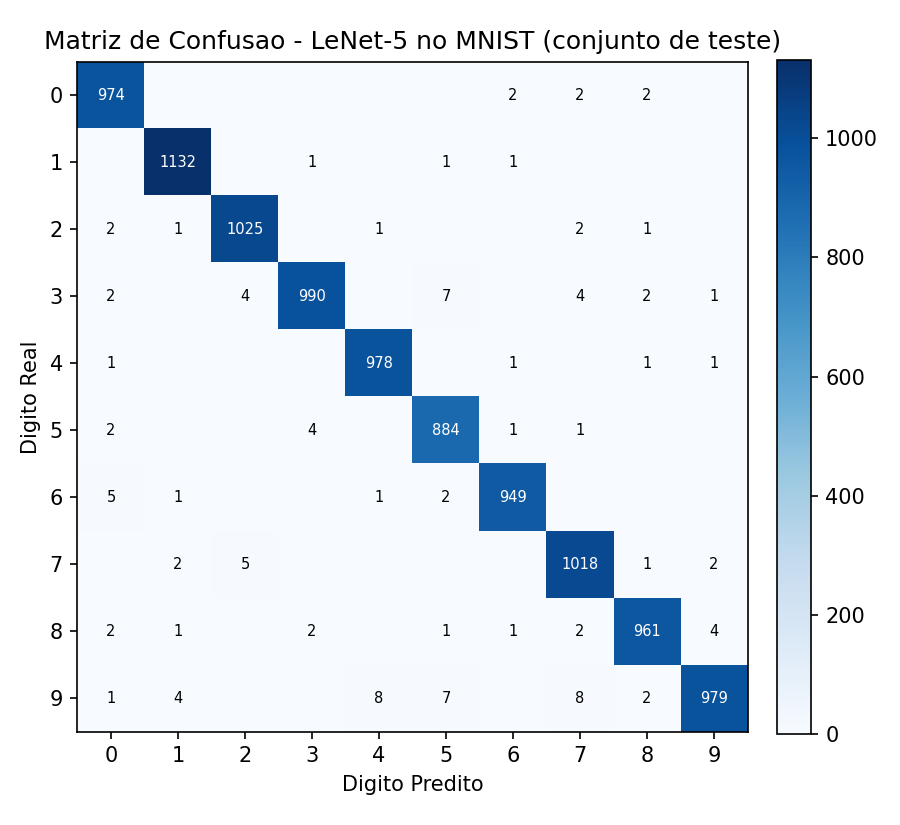
  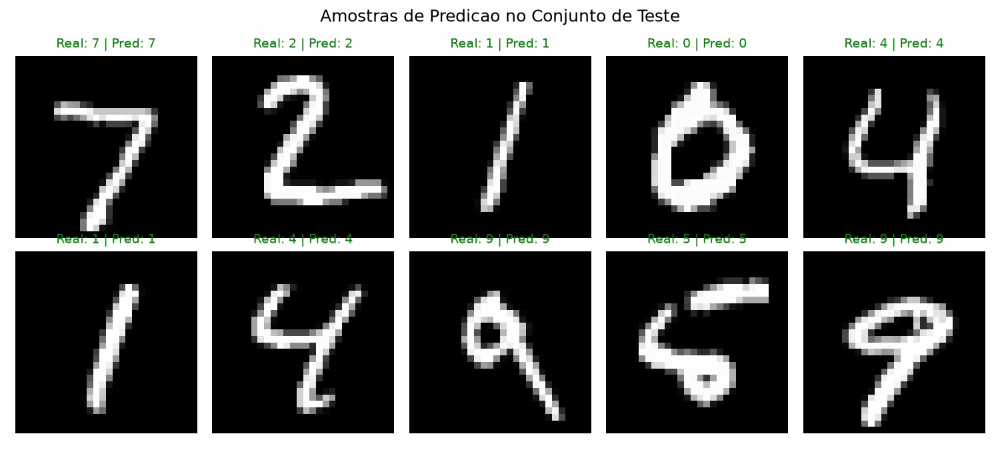
</p>

#### Modelo e demo no Hugging Face
[](https://huggingface.co/Acciolyyy/lenet5-mnist-unb) [](https://huggingface.co/spaces/Acciolyyy/lenet5-mnist-demo)

- **Modelo:** [Acciolyyy/lenet5-mnist-unb](https://huggingface.co/Acciolyyy/lenet5-mnist-unb) (pesos da semente 42 em `safetensors` e `ONNX`, 98,64% no teste; a média das 5 sementes continua 98,74% ± 0,07).
- **Demo no navegador:** [Acciolyyy/lenet5-mnist-demo](https://huggingface.co/spaces/Acciolyyy/lenet5-mnist-demo), um Space estático em `../hf-space-static/` (HTML, JS e onnxruntime-web, sem servidor). Um "X" desenhado pode ser classificado como dígito com confiança alta; veja as limitações.
- **Demo local em Gradio:** `../hf-space/app.py` (`python ../hf-space/app.py`), mesma rede e mesmo pré-processamento em Python; baixa os pesos do repositório do modelo. Não está publicada, porque Spaces Gradio exigem plano pago.
- Exportar os pesos: `python src/projeto_04_deep_learning.py --save-weights ../hf`; exportar para ONNX e testar a paridade: `python ../hf/export_onnx.py`.

## Limitações
Hiperparâmetros fixos, sem busca sistemática (Gradient Boosting, α e γ do Q-Learning, épocas e taxa da LeNet-5). Wine tem só 178 amostras. O grid do Q-Learning é determinístico e pequeno. A validação do MNIST tem 5 mil amostras (ruído de ±0,19 entre sementes), o treino é curto e não há aumento de dados. A LeNet-5 é um classificador de conjunto fechado: sempre escolhe um dos 10 dígitos e não tem a opção "não é um dígito"; entradas fora da distribuição podem receber confiança alta mesmo erradas (exemplo testado na demo: um "X" classificado como 7 com 84%). O aviso de baixa confiança da demo é só uma heurística e não resolve isso.

## Reexecutar
Python 3.12 e `pip install -r ../requirements.txt`. A partir desta pasta (as figuras vão para `imagens/`, e o MNIST é baixado em `mnist_data/`, ignorado pelo git):

```bash
python src/projeto_01_supervisionado.py
python src/projeto_02_nao_supervisionado.py
python src/projeto_03_reforco.py --seeds 10      # sem --seeds: uma execução e as figuras
python src/projeto_04_deep_learning.py --seeds 5
```
